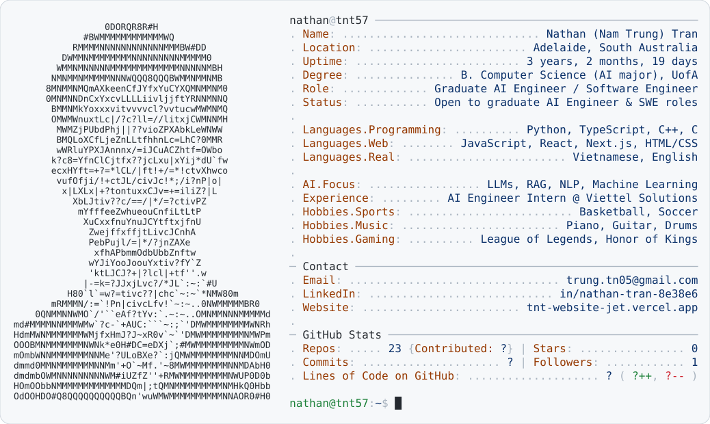

<a href="https://tnt-website-jet.vercel.app">
  <picture>
    <source media="(prefers-color-scheme: dark)" srcset="./dark_mode.svg">
    <source media="(prefers-color-scheme: light)" srcset="./light_mode.svg">
    
  </picture>
</a>

  <a href="https://tnt-website-jet.vercel.app">🌐 Website</a> &nbsp;·&nbsp;
  <a href="https://www.linkedin.com/in/nathan-tran-8e38e6/">💼 LinkedIn</a> &nbsp;·&nbsp;
  <a href="mailto:trung.tn05@gmail.com">📫 Email</a>

### Featured projects

| Project | What it does | Links |
| --- | --- | --- |
| **Auto-Updating VISA Intelligence System** | Answers real questions about Australia's 485 visa and cites the government page each answer came from. 80% top-1 retrieval accuracy. | [Repo](https://github.com/TNT57/Auto-updating-VISA-Intelligence-System) · [Demo](https://auto-updating-visa-intelligence-system.streamlit.app/) |
| **NBA Fair-Value Model** | Predicts what an NBA player is actually worth from on-court performance alone, then flags who's overpaid or underpaid. R² ≈ 0.73. | [Repo](https://github.com/TNT57/NBA-fair-value) · [Demo](https://nba-fair-value.streamlit.app/) |
| **PriceCheck AU** | Compares grocery prices across Coles, Woolworths and Aldi: 63,000+ products tracked live. | [Demo](https://price-check-au.vercel.app) |
| **Everything Larper** | A Claude Skill that turns a one-line persona prompt into fan commentary that reads like a real fan wrote it. | [Repo](https://github.com/TNT57/Everything-Larper) |

<!--
The card above is made by scripts/ and updated every day by .github/workflows/update-profile.yml.
To change your info, edit profile/config.toml and push. To change the portrait, replace profile/photo.jpg.
-->
