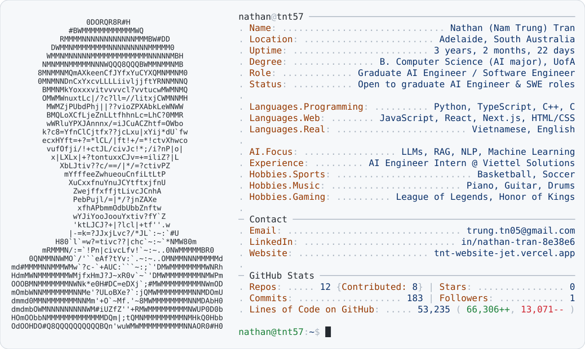
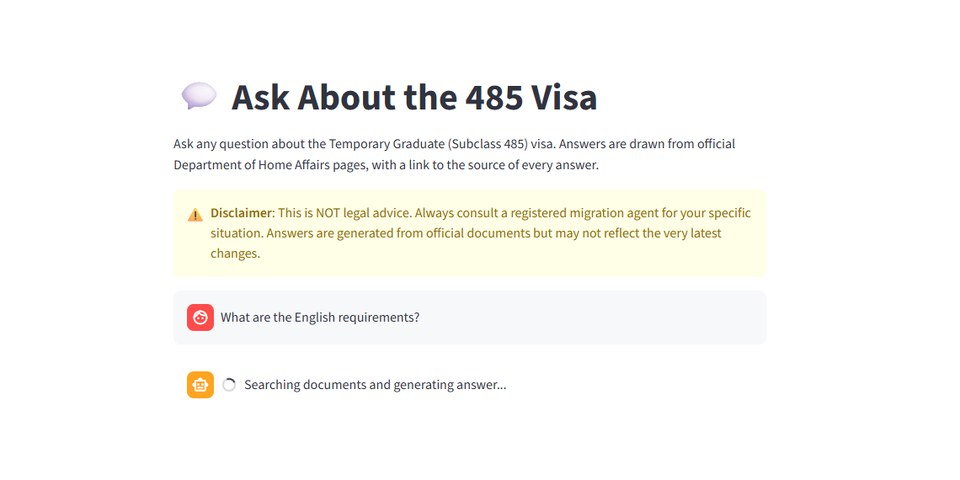
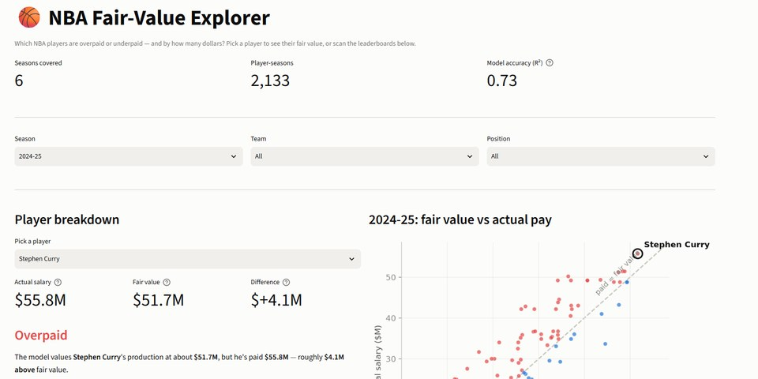
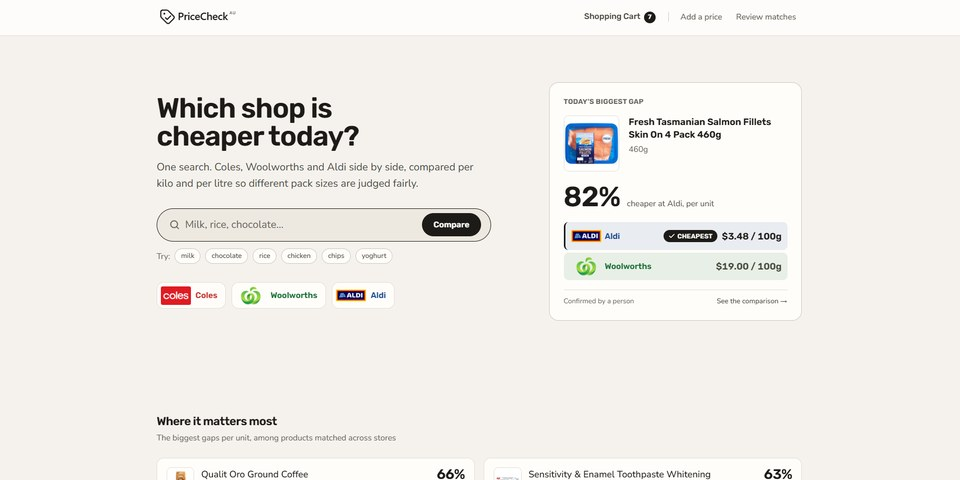
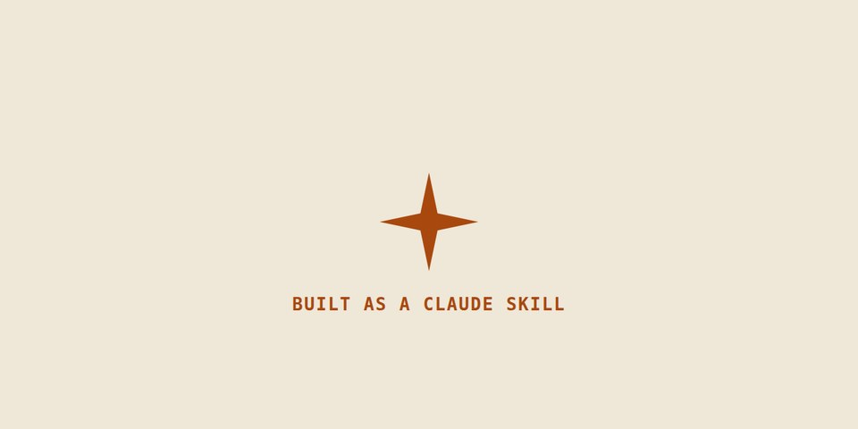
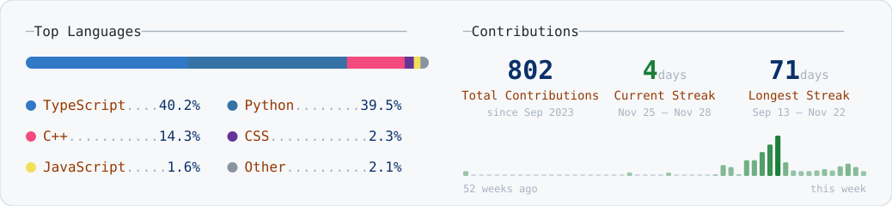

<a href="https://tnt-website-jet.vercel.app">
  <picture>
    <source media="(prefers-color-scheme: dark)" srcset="./assets/card_dark.svg">
    <source media="(prefers-color-scheme: light)" srcset="./assets/card_light.svg">
    
  </picture>
</a>

  
  
  
  
  

## Hi, I'm Nathan 👋

I'm a Vietnamese software engineer in Adelaide. I finished my Computer Science degree at the University of Adelaide in 2026, majoring in AI, and I'm now looking for my first full-time role as an **AI engineer or software engineer**.

At **Viettel Solutions** I fine-tuned and tested NLP models before they shipped. As a **research assistant**, I used large language models to automate threat-intelligence analysis. What I enjoy most is building the whole thing myself: getting the data, training and checking the model, then shipping something you can actually click on.

Off the keyboard, I'm vice-president of a Vietnamese community soccer club here in Adelaide. I also play basketball, and I play piano, guitar and a bit of drums.

## 🔨 What I'm building right now

- **[Study Blog Platform](https://github.com/TNT57/Study-Blog-Platform)** ([live](https://study-blog-platform.vercel.app)): I'm learning real software engineering the hard way. I wrote my own login system (Argon2id passwords, database sessions), I write raw SQL before switching to an ORM, every page gets accessibility tests, and CI runs on every pull request.
- **[Két Sách](https://github.com/TNT57/SangRaDocGi)**: a small Vietnamese reading app. You open a "crate" and get a short piece of public-domain Vietnamese literature you can read in under 10 minutes. You can install it on your phone's home screen.
- **[PriceCheck AU](https://price-check-au.vercel.app)**: keeping more than 63,000 grocery prices fresh across Coles, Woolworths and Aldi.

## 🚀 Projects I'm proud of

<table>
  <tr>
    <td width="50%" valign="top">
      
      <h3>🛂 VISA Intelligence System</h3>
      
Ask a question about Australia's 485 visa and get an answer that <b>cites the exact government page</b> it came from. Every night it checks homeaffairs.gov.au for changes and updates itself.

      
📈 Top-1 retrieval accuracy <b>50% → 80%</b>, after I fixed the gap between how people ask questions and how the government writes its pages.

      

        
        
        
        
      

      <a href="https://auto-updating-visa-intelligence-system.streamlit.app/"><b>▶ Live demo</b></a> · <a href="https://github.com/TNT57/Auto-updating-VISA-Intelligence-System">Code</a>
    </td>
    <td width="50%" valign="top">
      
      <h3>🏀 NBA Fair-Value Model</h3>
      
How much is an NBA player really worth? The model learns a <b>fair salary from on-court stats only</b> (it never sees the real salary), then shows who is overpaid or underpaid, in dollars.

      
📈 <b>R² ≈ 0.73</b> on seasons the model never saw, across 6 seasons and ~2,100 player-seasons.

      

        
        
        
        
      

      <a href="https://nba-fair-value.streamlit.app/"><b>▶ Live demo</b></a> · <a href="https://github.com/TNT57/NBA-fair-value">Code</a>
    </td>
  </tr>
  <tr>
    <td width="50%" valign="top">
      
      <h3>🛒 PriceCheck AU</h3>
      
Which shop is cheaper today? It compares <b>Coles, Woolworths and Aldi</b> side by side, per kilo and per litre, so different pack sizes are judged fairly. Every price is saved as history, never overwritten.

      
📈 <b>63,662 products</b> tracked across 3 supermarket chains. Built and deployed solo.

      

        
        
        
      

      <a href="https://price-check-au.vercel.app"><b>▶ Live site</b></a> · <i>code is private</i>
    </td>
    <td width="50%" valign="top">
      
      <h3>🎙️ Everything Larper</h3>
      
A Claude Skill that turns a one-line persona prompt (like <i>"90s Bulls superfan"</i>) into fan commentary that sounds like a real fan wrote it, not like generic AI text.

      
📈 Checked against a written rubric, including <b>adversarial tests</b> (fake-quote and injury-bait prompts) to make sure the rules about real people hold.

      

        
        
      

      <a href="https://github.com/TNT57/Everything-Larper"><b>Install it</b></a> · <a href="https://github.com/TNT57/Everything-Larper/tree/main/evals">Evals</a>
    </td>
  </tr>
</table>

## 🧰 Tools I reach for

  <b>AI &amp; data</b> 
  

  <b>Web</b> 
  

  <b>Systems &amp; shipping</b> 
  

Also: LLM apps and RAG (Groq, SentenceTransformers, ChromaDB), web scraping (Playwright, BeautifulSoup), testing (pytest, Vitest, Playwright + axe).

## 📊 Activity

<picture>
  <source media="(prefers-color-scheme: dark)" srcset="./assets/activity_dark.svg">
  <source media="(prefers-color-scheme: light)" srcset="./assets/activity_light.svg">
  
</picture>

<picture>
  <source media="(prefers-color-scheme: dark)" srcset="./assets/snake_dark.svg">
  <source media="(prefers-color-scheme: light)" srcset="./assets/snake_light.svg">
  
</picture>

## 📫 Say hi

I'm happy to chat about graduate roles, AI projects, or who the most underpaid player in the NBA is. The fastest way to reach me is **[email](mailto:trung.tn05@gmail.com)** or **[LinkedIn](https://www.linkedin.com/in/nathan-tran-8e38e6/)**.

<!--
How this page works:
- The cards in assets/ are built by scripts/ and refreshed every day by .github/workflows/update-profile.yml.
- To change your info: edit profile/config.toml and push. To change the portrait: replace profile/photo.jpg.
-->
